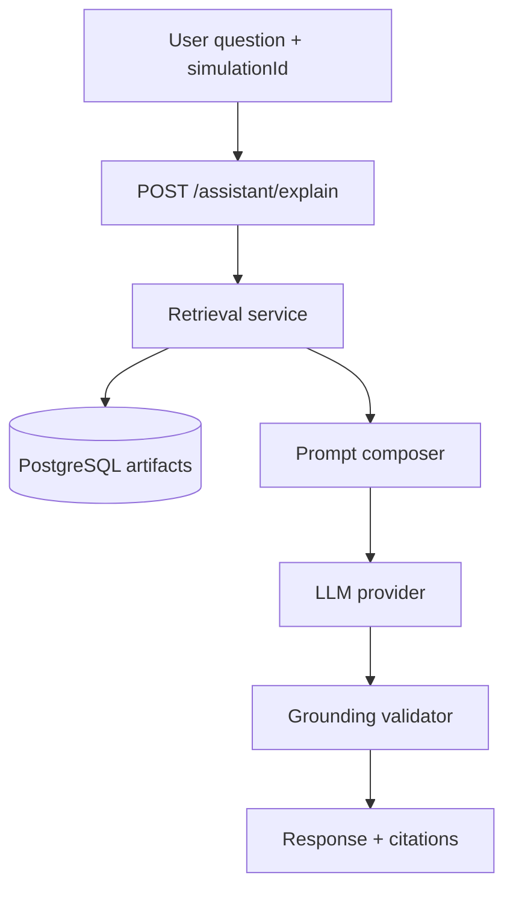
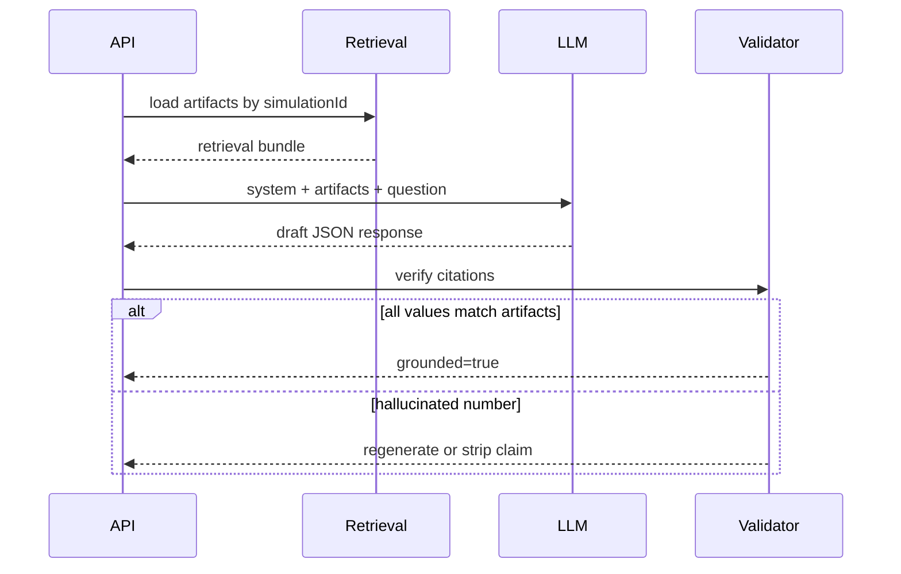

# AI Assistant Architecture

**Phase:** 10.6 — Platform Architecture Design  
**Date:** 2026-06-14  
**Engine baseline:** `runtime-core@1.8.0` (frozen — assistant never invokes engine)  
**Status:** Design only — Phase 14 implementation

---

## 1. Purpose

The AI Assistant helps mathematicians and QA engineers **interpret** validation reports, simulation results, and mathematical metrics. It is not a chatbot for inventing game math.

**Hard rule:** Every numeric claim in a response must cite a retrieved artifact field. If data is missing, the assistant says so — it does not estimate RTP, volatility, or frequencies.

---

## 2. Position in the platform



The assistant **never** calls:

- `run_simulation`
- `SessionExecutor`
- `ValidationEngine` (except via pre-stored reports)
- `build_mathematics_report` at explain time (uses persisted report)

---

## 3. Retrieval sources

| Source ID | DB table / field | Use |
|-----------|------------------|-----|
| `game_version` | `game_versions.canonical_json` | Paytable, states, plugins, limits |
| `validation_report` | Stored on validate action (optional cache) | Structural issues |
| `simulation_run` | `simulation_runs.profile_json` + metadata | Spin count, shards, engine pin |
| `simulation_results` | `simulation_results.result_json` | Aggregates, faults, features |
| `mathematics_reports` | `mathematics_reports.report_json` | RTP, CI, volatility, buckets |
| `spin_wins_sample` | `mathematics_reports.spin_wins_sample_json` | Distribution examples |
| `golden_expected` | Admin fixture YAML (read-only) | Expected baseline comparison |
| `engine_capabilities` | `GET /engine/version` snapshot | Plugin list, RNG policy |

### Retrieval policy

1. **Required context:** `simulationId` → load run + results; if question mentions RTP/volatility, require `mathematics_reports`
2. **Optional context:** `includeValidationReport`, `includeWinDistribution` flags from API request
3. **Token budget:** Truncate `canonical_json` to relevant subgraph (machine/state mentioned in question) via JSON pointer paths
4. **No web search** in MVP

---

## 4. Prompt templates

### 4.1 System prompt (fixed)

```
You are a game mathematics assistant for an iGaming simulation platform.

RULES:
1. Answer ONLY using the ARTIFACTS JSON provided below.
2. Every number you state MUST appear in ARTIFACTS or be a simple ratio explicitly computable from two cited fields (e.g. RTP = totalWin / totalBet).
3. If ARTIFACTS lack data to answer, reply: "Insufficient artifact data" and list what is missing.
4. Never suggest changing game logic, RNG, or engine code.
5. Cite fields as [source.field] matching the citations schema.
6. Engine version is runtime-core@1.8.0 — do not claim a different version.

You do NOT execute simulations or compute new metrics.
```

### 4.2 User prompt template

```
QUESTION:
{user_question}

SIMULATION CONTEXT:
- simulationId: {simulation_id}
- engineVersion: {engine_version}
- gameContentHash: {content_hash}

ARTIFACTS:
{serialized_retrieval_bundle}

Respond in JSON:
{
  "answer": "<prose>",
  "citations": [{"source": "...", "field": "...", "value": "..."}],
  "missingData": []
}
```

### 4.3 Question-type templates (orchestrator selects)

| Intent | Extra instruction |
|--------|-------------------|
| `explain_rtp` | Focus on `report.rtp` and simulation totals; mention exposure if truncated |
| `explain_volatility` | Use `report.volatility` and CI width |
| `explain_faults` | Use `result.chainFaultCount` vs `spinCount`; do not speculate on root cause without events |
| `compare_golden` | Diff expected.yaml fields vs actual when golden fixture linked |
| `explain_features` | Use `featureTriggerCounts` and `featureFrequencies` |

Intent classification: lightweight keyword router in MVP; small classifier model in enterprise.

---

## 5. Grounding strategy



### 5.1 Citation format

Each citation must resolve to a JSON path in the retrieval bundle:

```json
{
  "source": "simulation_results",
  "field": "result.totalWinMinorUnits",
  "value": "103070000"
}
```

### 5.2 Post-generation validation

1. Parse all numbers from `answer` prose
2. Each number must match a cited `value` (± formatting tolerance) or derive from cited pair (RTP ratio)
3. Unmatched numbers → `grounded: false`, redact sentence or re-prompt once with stricter temperature

### 5.3 Temperature and model settings

| Parameter | MVP value |
|-----------|-----------|
| `temperature` | 0.0 – 0.2 |
| `response_format` | JSON schema enforced |
| `max_tokens` | 1024 |

---

## 6. Hallucination prevention

| Risk | Mitigation |
|------|------------|
| Invented RTP | Require `mathematics_reports`; cite `report.rtp.rtp` |
| Wrong engine version | Inject pin in system prompt; validate against deployment |
| Fabricated feature rates | Only `featureTriggerCounts` / `featureFrequencies` |
| Causal claims without events | Block language like "because scatter landed" unless `eventSampleCount > 0` and events in bundle |
| Generic slot advice | System prompt forbids non-artifact recommendations |
| Stale data | Include `createdAt` timestamps in bundle; warn if simulation > N days old |

**Refusal templates:**

- "Insufficient artifact data: mathematics report not found for this simulation."
- "Event log not sampled (`eventSampleCount: 0`); cannot explain step-level outcomes."

---

## 7. Evaluation approach

### 7.1 Golden Q&A set (Phase 14 deliverable)

Build `tests/assistant/golden_qa.yaml` paired with golden fixtures:

| Fixture | Question | Expected citation fields |
|---------|----------|--------------------------|
| analytic-4spin-bucketed | What is RTP? | `report.rtp.rtp` = 1.875 |
| fixture-01 (1M sim) | What is hit frequency? | `report.hitFrequency.hitFrequency` |

**Metrics:**

| Metric | Target |
|--------|--------|
| Citation accuracy | 100% on golden set |
| Numeric hallucination rate | 0% on golden set |
| Refusal correctness | 100% when artifacts missing |

### 7.2 Automated eval pipeline

```
For each (simulationId, question, expected_citations):
  1. POST /assistant/explain
  2. Assert response.grounded == true
  3. Assert expected fields ⊆ response.citations
  4. Optional: LLM-as-judge with frozen rubric (human review sample)
```

### 7.3 Human review

- Sample 5% of production explanations (Phase 15)
- Rubric: factual, cited, actionable, no engine change suggestions

---

## 8. Security and privacy

| Concern | Handling |
|---------|----------|
| `masterSeed` | Never in retrieval bundle |
| Cross-tenant leakage | Repository filters by `organization_id` before retrieval |
| Prompt injection | Sanitize user question; artifacts in system-side JSON only |
| PII | User email not passed to LLM in MVP |

---

## 9. MVP vs enterprise

| Feature | MVP (Phase 14) | Enterprise |
|---------|----------------|------------|
| LLM provider | Single vendor (env config) | BYOK / Azure OpenAI |
| Retrieval | PostgreSQL JSON | + vector search on event samples |
| Multi-turn chat | Single Q&A | Thread storage with artifact snapshot per turn |
| Golden diff | Manual fixture link | Automated expected.yaml import |

---

## 10. API contract summary

See [API_SPECIFICATION.md](./API_SPECIFICATION.md) §6 `POST /assistant/explain`.

---

## References

- [PLATFORM_ARCHITECTURE.md](./PLATFORM_ARCHITECTURE.md)
- [CURSOR_RULES.md](./CURSOR_RULES.md) §8 — Mathematical Engine boundaries (same artifact-only rule applies)
- [CERTIFICATION_READINESS.md](./CERTIFICATION_READINESS.md)
