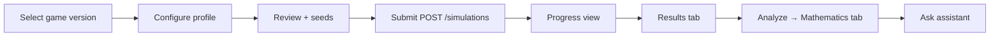

# Frontend Architecture

**Phase:** 10.6 — Platform Architecture Design  
**Date:** 2026-06-14  
**Target:** React SPA (Phase 13)  
**Status:** Design only — no implementation

---

## 1. Goals

- Mathematician-friendly workflow: **define → validate → simulate → analyze → explain**
- Zero direct engine imports — all data via REST API
- Deterministic display of engine artifacts (integer money, pinned versions)
- Golden fixture parity for regression demos

---

## 2. Technology stack

| Layer | Choice | Rationale |
|-------|--------|-----------|
| Framework | React 19 + TypeScript | Ecosystem, OpenAPI client gen |
| Build | Vite | Fast dev, ESM |
| Routing | React Router v7 | Nested layouts |
| Server state | TanStack Query v5 | Polling simulations, cache invalidation |
| Client state | Zustand (minimal) | Wizard step, UI prefs only |
| Forms | React Hook Form + Zod | Mirrors API validation |
| Charts | Recharts | RTP, distribution buckets |
| Styling | Tailwind CSS + shadcn/ui | Consistent dashboard |
| API client | `openapi-fetch` from generated types | Type-safe |

**Package location:** `packages/web/`

---

## 3. Application structure

```
packages/web/
├── src/
│   ├── main.tsx
│   ├── app/
│   │   ├── router.tsx
│   │   ├── layout/
│   │   │   ├── AppShell.tsx
│   │   │   ├── Sidebar.tsx
│   │   │   └── TopBar.tsx
│   │   └── providers/
│   │       ├── QueryProvider.tsx
│   │       └── AuthProvider.tsx
│   ├── features/
│   │   ├── games/
│   │   ├── simulations/
│   │   ├── mathematics/
│   │   ├── golden/
│   │   └── assistant/
│   ├── api/
│   │   ├── client.ts
│   │   └── generated/          # OpenAPI output
│   ├── components/             # Shared UI
│   └── lib/
│       ├── format.ts           # Money, RTP % display
│       └── engine.ts           # Version pin constants
└── tests/
```

---

## 4. Routing

```mermaid
flowchart TD
    ROOT[/] --> DASH[/dashboard]
    ROOT --> GAMES[/games]
    GAMES --> GAME_DETAIL[/games/:gameId]
    GAMES --> GAME_NEW[/games/new]
    ROOT --> SIM[/simulations]
    SIM --> SIM_NEW[/simulations/new]
    SIM --> SIM_DETAIL[/simulations/:simulationId]
    ROOT --> GOLDEN[/golden]
    GOLDEN --> GOLDEN_FIX[/golden/:fixtureId]
    ROOT --> ASSIST[/assistant]
    ROOT --> SETTINGS[/settings]
```

| Route | Screen | Primary API |
|-------|--------|-------------|
| `/dashboard` | KPI cards, recent runs | `GET /games`, `GET /simulations` |
| `/games` | Game list | `GET /games` |
| `/games/new` | Upload / edit canonical JSON | `POST /games/validate`, `POST /games` |
| `/games/:id` | Version history, validate button | `GET /games/{id}` |
| `/simulations/new` | Simulation wizard | `POST /simulations` |
| `/simulations/:id` | Progress + results + analyze | `GET /simulations/{id}`, `/results` |
| `/golden` | Fixture catalog | Static manifest + API validate |
| `/golden/:fixtureId` | Side-by-side expected vs API | Golden + simulation |
| `/assistant` | Q&A panel linked to simulation | `POST /assistant/explain` |

**Auth guard:** All routes except public marketing (future) require JWT in `AuthProvider`.

---

## 5. State management

### 5.1 Server state (TanStack Query)

| Query key | Endpoint | Behavior |
|-----------|----------|----------|
| `['engine', 'version']` | `GET /engine/version` | Stale ∞ — refetch on app load |
| `['games']` | `GET /games` | Invalidate on create |
| `['games', id]` | `GET /games/{id}` | |
| `['simulations', id]` | `GET /simulations/{id}` | Poll every 2s while `pending`/`running` |
| `['simulations', id, 'results']` | `GET /simulations/{id}/results` | Enabled when status `completed` |
| `['mathematics', simulationId]` | From analyze POST response | Cached after analyze |

### 5.2 Client state (Zustand)

```typescript
// Illustrative — design only
interface SimulationWizardStore {
  step: 'game' | 'profile' | 'review' | 'running';
  gameVersionId: string | null;
  profile: SimulationProfileDraft;
  reset: () => void;
}
```

No simulation results in global client store — always from server cache.

---

## 6. API layer

```typescript
// api/client.ts — design pattern
import createClient from 'openapi-fetch';
import type { paths } from './generated/api';

export const api = createClient<paths>({
  baseUrl: import.meta.env.VITE_API_BASE_URL,
});

// Interceptor: attach JWT, X-Request-Id
```

**Error handling:**

- 422 validation → render `ValidationReport` component with findings table
- 409 simulation not ready → disable results tab
- 503 → retry with exponential backoff on poll queries

---

## 7. Dashboard structure

```
┌─────────────────────────────────────────────────────────────┐
│ TopBar: org name | engine version badge | user menu         │
├──────────┬──────────────────────────────────────────────────┤
│ Sidebar  │ Dashboard                                        │
│          │ ┌────────────┐ ┌────────────┐ ┌────────────┐     │
│ Games    │ │ Games: 12  │ │ Runs: 48   │ │ Engine pin │     │
│ Sims     │ └────────────┘ └────────────┘ └────────────┘     │
│ Golden   │ Recent simulations table                         │
│ Assistant│ Quick actions: [New Game] [New Simulation]       │
└──────────┴──────────────────────────────────────────────────┘
```

**Engine version badge:** Displays `runtime-core@1.8.0` from `/engine/version`; warns if API ≠ expected deploy pin.

---

## 8. Simulation workflow UI



### Step details

| Step | UI | Validation |
|------|-----|------------|
| Game | Dropdown of `game_versions` | Required |
| Profile | `spinCount`, `shardCount`, hex seed | Zod: spinCount ≤ max from engine |
| Review | Summary card | Show content hash |
| Running | Progress bar `shardsCompleted/shardsTotal` | Poll `GET /simulations/{id}` |
| Results | Tables: bets, wins, faults, features | Read-only JSON toggle |
| Mathematics | RTP, CI, volatility, bucket chart | Trigger `POST /mathematics/analyze` |
| Assistant | Chat panel pre-loaded with simulationId | Citations expandable |

---

## 9. Golden fixture viewer

Read-only admin/education tool mirroring CI golden contracts.

```
/golden
├── Lists tests/golden/manifest.yaml fixtures (fetched or bundled)
└── /golden/fixture-01-base-5x3
    ├── Canonical JSON viewer (read-only)
    ├── Expected runtime metrics (from expected.yaml)
    ├── Button: "Run validation via API"
    ├── Button: "Run single-chain simulation" (small spin count)
    └── Diff panel: expected vs actual (field-level)
```

**Data sources:**

- Static YAML/JSON copied or served from API `GET /golden/fixtures` (Phase 13 admin endpoint — optional)
- MVP: bundle manifest at build time for offline demo

**Purpose:** Prove API + engine parity with CI golden suite without exposing raw engine in browser.

---

## 10. Formatting and display rules

| Data type | Display |
|-----------|---------|
| RTP | Percentage to 4 decimals (`5.1535%`) |
| Money | Integer minor units + optional formatted column |
| Seeds | Masked in UI except at creation time |
| Engine version | Always visible on simulation detail |
| Fault count | Warning badge if `chainFaultCount > 0` |

---

## 11. Testing strategy (Phase 13)

| Type | Tool |
|------|------|
| Unit | Vitest + Testing Library |
| API integration | MSW mocks from OpenAPI |
| E2E | Playwright against docker-compose stack |
| Golden UI | Snapshot of fixture viewer diff panel |

---

## References

- [API_SPECIFICATION.md](./API_SPECIFICATION.md)
- [PLATFORM_ARCHITECTURE.md](./PLATFORM_ARCHITECTURE.md)
- [GOLDEN_FIXTURES_V1.md](./GOLDEN_FIXTURES_V1.md)
