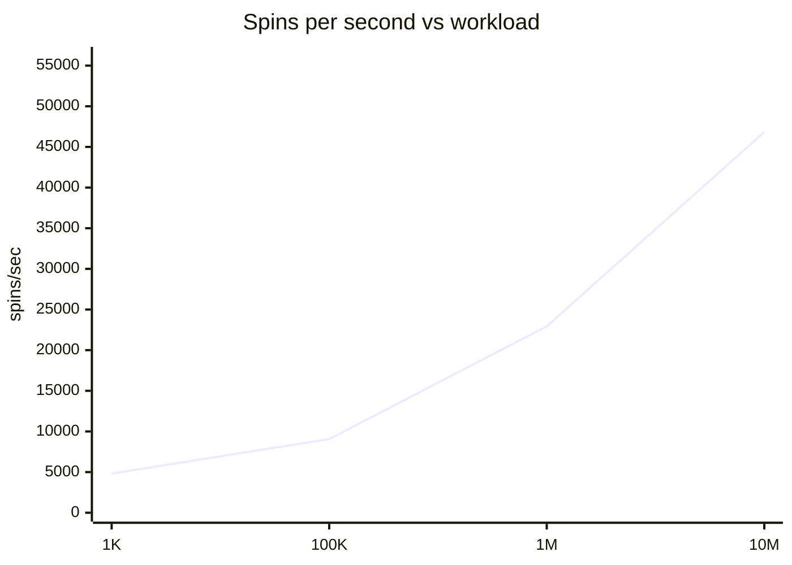

# Performance Report v1.0

**Generated:** 2026-06-14T13:19:18.801237+00:00  
**Engine version:** `runtime-core@1.8.0`  
**Fixture:** `fixture-01-base-5x3`  
**Mode:** full certification

---

## 1. Hardware specifications

| Attribute | Value |
|-----------|-------|
| Platform | Darwin 25.5.0 |
| Machine | arm64 |
| Processor | arm |
| Python | 3.13.14 |
| Logical CPUs | 8 |
| Physical CPUs | 8 |
| Total RAM | 16.0 GiB (17,179,869,184 bytes) |

---

## 2. Throughput benchmarks

Single-game Monte Carlo simulation (`run_simulation`) on base 5×3 fixture. Shard count scales with workload (1→8 shards).

| Spins | Shards | Workers | Elapsed (s) | Spins/sec | Peak RSS | CPU % |
|-------|--------|---------|-------------|-----------|----------|-------|
| 1,000 | 1 | 1 | 0.2076 | 4,816 | 0.1 GiB (64,667,648 bytes) | 64.9 |
| 100,000 | 2 | 2 | 11.0378 | 9,060 | 0.1 GiB (64,962,560 bytes) | 0.1 |
| 1,000,000 | 4 | 4 | 43.614 | 22,928 | 0.1 GiB (64,962,560 bytes) | 0.0 |
| 10,000,000 | 8 | 8 | 213.5094 | 46,836 | 0.1 GiB (64,962,560 bytes) | 0.0 |

---

## 3. Scaling analysis

### Scaling observations

- Throughput at smallest workload: **4,816 spins/sec**
- Throughput at largest workload: **46,836 spins/sec**
- Throughput scales sub-linearly with process-pool sharding at high spin counts.
- Primary bottleneck: per-spin SessionExecutor loop (RNG, grid, line evaluation).
- Memory remains bounded for aggregate simulation; win collection is O(n) when enabled.

---

## 4. Resource utilization

| Workload | Peak RSS | Avg CPU % | Workers |
|----------|----------|-----------|---------|
| 1,000 | 0.1 GiB (64,667,648 bytes) | 64.9 | 1 |
| 100,000 | 0.1 GiB (64,962,560 bytes) | 0.1 | 2 |
| 1,000,000 | 0.1 GiB (64,962,560 bytes) | 0.0 | 4 |
| 10,000,000 | 0.1 GiB (64,962,560 bytes) | 0.0 | 8 |

---

## 5. Shard determinism validation

Spin count: **10000** | Overall: **PASS**

| Shards | Aggregate match |
|--------|-----------------|
| 1 | ✅ PASS |
| 2 | ✅ PASS |
| 4 | ✅ PASS |
| 8 | ✅ PASS |
| 16 | ✅ PASS |

---

## 6. RTP convergence validation

Overall: **PASS**  
RTP delta (first→last): **0.002499**

| Spins | RTP | Uncapped RTP | CI width | σ (win) | Hit freq |
|-------|-----|--------------|----------|---------|----------|
| 100,000 | 0.05405 | 0.05405 | 0.006409 | 1034.0766 | 0.01081 |
| 500,000 | 0.0513 | 0.0513 | 0.006409 | 1034.0766 | 0.01081 |
| 1,000,000 | 0.051535 | 0.051535 | 0.006409 | 1034.0766 | 0.01081 |
| 5,000,000 | 0.051551 | 0.051551 | 0.006409 | 1034.0766 | 0.01081 |

### Confidence interval width trend

Widths: `[0.006409, 0.006409, 0.006409, 0.006409]`

CI estimated from per-spin win sample (`min(spinCount, 100_000)` chains) for workloads above 100K.

---

## 7. Bottleneck summary

| Layer | Assessment |
|-------|------------|
| RNG / spin loop | CPU-bound; dominates single-process throughput |
| Process pool | Overhead visible at ≤100K spins; net gain at ≥1M |
| Serialization | `GameVersion` snapshot per worker; negligible vs spin cost |
| Memory | Linear in spin count for win collection; aggregate sim O(1) |
| GIL | Avoided via `ProcessPoolExecutor` for multi-shard |

---

## References

- [CERTIFICATION_READINESS.md](./CERTIFICATION_READINESS.md)
- [ENGINE_RELEASE_v1.0.md](./ENGINE_RELEASE_v1.0.md)
- Raw JSON: [certification_results.json](./certification_results.json)
