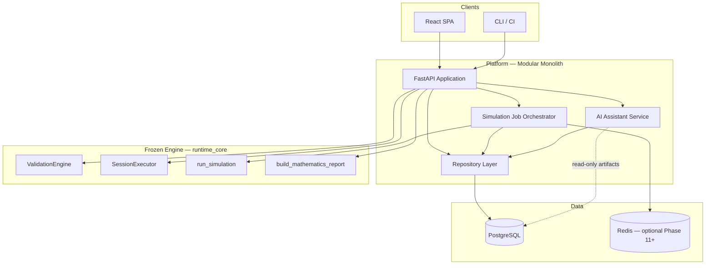
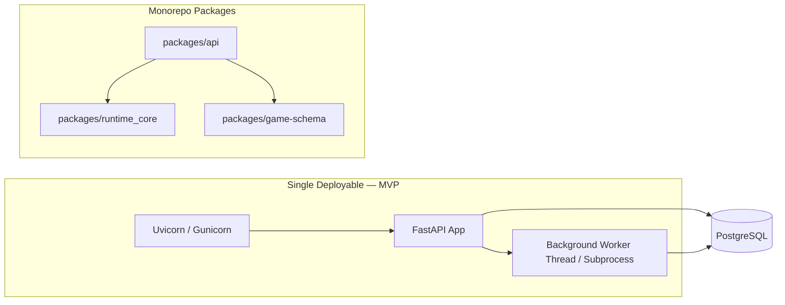
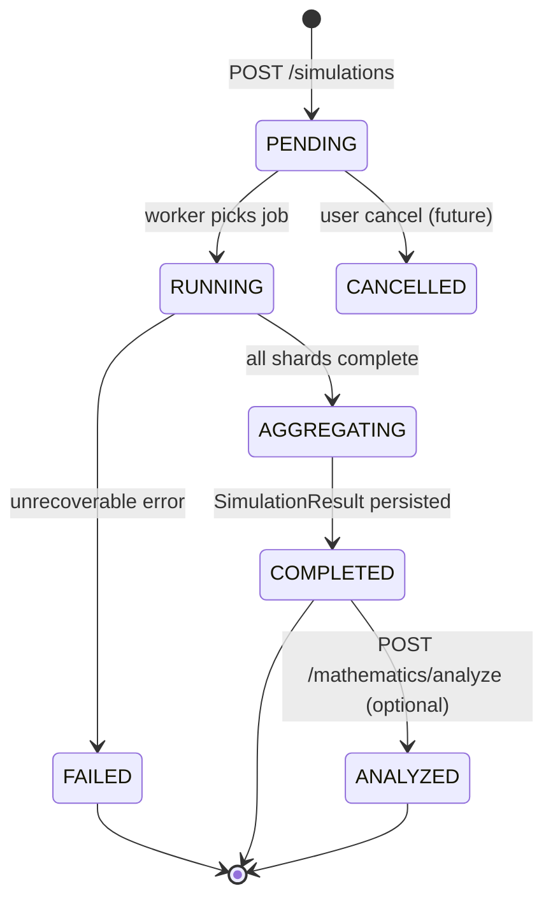
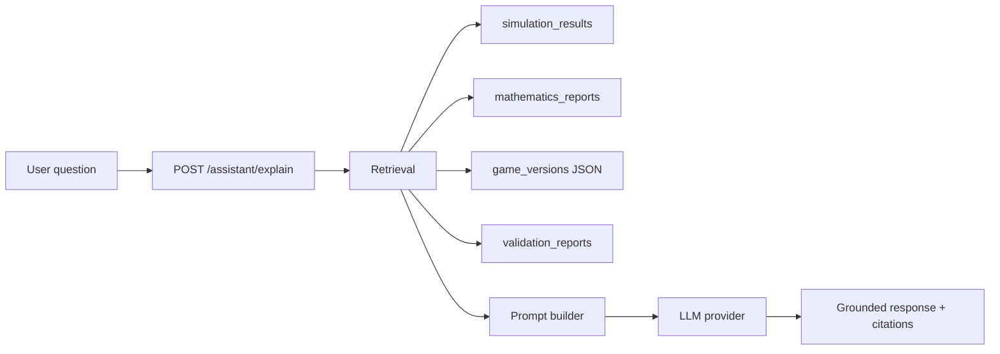
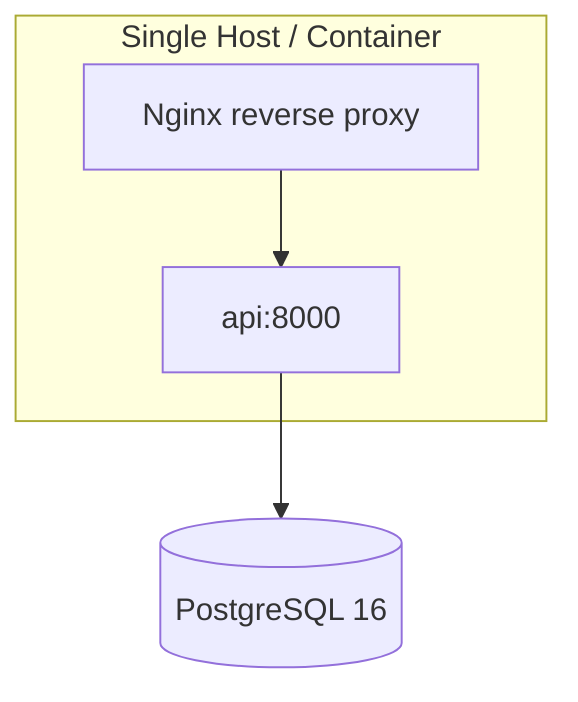

# Platform Architecture

**Phase:** 10.6 — Platform Architecture Design  
**Date:** 2026-06-14  
**Engine baseline:** `runtime-core@1.8.0` (frozen)  
**Status:** Design only — no implementation

---

## 1. Purpose

This document defines the **platform layer** that wraps the frozen mathematics engine. The platform provides HTTP access, persistence, UI, and AI explainability without modifying engine behavior.

**Related documents:**

| Document | Scope |
|----------|-------|
| [DATABASE_SCHEMA.md](./DATABASE_SCHEMA.md) | PostgreSQL entities |
| [API_SPECIFICATION.md](./API_SPECIFICATION.md) | REST contracts |
| [FRONTEND_ARCHITECTURE.md](./FRONTEND_ARCHITECTURE.md) | React SPA |
| [AI_ASSISTANT_ARCHITECTURE.md](./AI_ASSISTANT_ARCHITECTURE.md) | Grounded explanations |
| [ENGINE_RELEASE_v1.0.md](./ENGINE_RELEASE_v1.0.md) | Engine freeze |
| [ROADMAP_v2.md](./ROADMAP_v2.md) | Phases 11–15 |

---

## 2. Overall system architecture



### Layer responsibilities

| Layer | Owns | Must not own |
|-------|------|--------------|
| **Engine** (`runtime_core`) | Validation, spin execution, Monte Carlo, metrics | HTTP, auth, persistence, LLM calls |
| **Platform API** | Routing, auth, DTO mapping, job lifecycle, audit | Game logic, RNG, plugin execution |
| **Repository** | CRUD, transactions, content-addressed storage | Business rules inside engine |
| **Frontend** | UX, forms, charts, workflow state | Direct engine imports |
| **AI Assistant** | Retrieval, prompts, citations | Metric computation, spin execution |

---

## 3. Engine boundary definition

The engine is consumed **only** through published public APIs. Platform code imports `runtime_core` as a library dependency; it never reaches into internal modules (`runtime_core.runtime.executor.session_executor` internals, plugin implementations, etc.) except via documented entry points.

### 3.1 Allowed engine entry points

| Capability | Public API | Input | Output |
|------------|------------|-------|--------|
| Validate game | `ValidationEngine.validate(...)` | `GameVersion` or canonical JSON | `ValidationReport` |
| Single spin chain | `SessionExecutor.execute_spin_chain(...)` | `SpinChainRequest` | `SpinChainResult` |
| Monte Carlo | `run_simulation(...)` | `GameVersion`, `SimulationProfile` | `SimulationResult` |
| Statistics | `build_mathematics_report(...)` | `SimulationResult`, optional `spin_wins_minor_units` | `MathematicsReport` |
| Golden parity | `golden-runner` CLI | Fixture profiles | Comparison report |
| Version pin | `ENGINE_VERSION` | — | `runtime-core@1.8.0` |

### 3.2 Platform → engine mapping

```
HTTP Request
    → Pydantic API DTO
    → Adapter: DTO → GameVersion / SimulationProfile
    → engine public call
    → Adapter: engine result → API response DTO
    → Persist snapshot (PostgreSQL)
```

### 3.3 Forbidden patterns

- Reimplementing line evaluation, RNG, or transitions in API handlers
- Mutating `GameVersion` after validation (immutable snapshots only)
- Passing wall-clock timestamps into engine requests
- Patching engine modules at runtime
- Forking engine code into `packages/api/`

### 3.4 Version coupling

Every persisted artifact records `engineVersion`. Platform rejects simulation requests when client-requested engine version ≠ deployed pin unless explicitly running in **compat mode** (future enterprise feature).

---

## 4. Component diagram (deployment units)



### Planned package layout

```
packages/
├── runtime_core/          # Frozen engine (M0–M9)
├── game-schema/           # JSON schemas + registries
├── api/                   # FastAPI app (Phase 11)
│   ├── app/
│   │   ├── main.py
│   │   ├── routers/
│   │   ├── services/      # Orchestration only
│   │   ├── adapters/      # DTO ↔ engine models
│   │   ├── repositories/
│   │   └── jobs/
│   └── tests/
└── web/                   # React SPA (Phase 13)
```

---

## 5. FastAPI application architecture

### 5.1 Application structure

```
FastAPI App
├── Middleware
│   ├── Request ID / correlation ID
│   ├── Auth (JWT stub → SSO Phase 15)
│   ├── CORS
│   └── Structured logging (structlog)
├── Routers
│   ├── /health, /engine
│   ├── /games
│   ├── /simulations
│   ├── /mathematics
│   └── /assistant
├── Services (thin orchestration)
│   ├── GameService
│   ├── ValidationService      → ValidationEngine
│   ├── SimulationJobService   → run_simulation
│   ├── MathematicsService     → build_mathematics_report
│   └── AssistantService       → retrieval + LLM
└── Dependencies
    ├── get_db_session
    ├── get_current_user
    └── get_engine_version
```

### 5.2 Design principles

1. **Handlers are thin** — validate HTTP input, call service, map response
2. **Services coordinate** — repositories + engine adapters; no SQL in routers
3. **Adapters are explicit** — one module per engine boundary (`adapters/game_version.py`, `adapters/simulation.py`)
4. **Idempotency** — simulation create accepts optional `clientRequestId` for safe retries
5. **Async where I/O** — `async def` routes; engine calls run in `asyncio.to_thread()` or process pool to avoid blocking the event loop

### 5.3 Error model

| HTTP | Engine condition |
|------|------------------|
| 400 | Invalid JSON / schema / API validation |
| 422 | ValidationEngine findings (structured report in body) |
| 404 | Game or simulation not found |
| 409 | Duplicate content hash / idempotency conflict |
| 503 | Engine not ready / worker queue saturated |

### 5.4 OpenAPI

- Auto-generated from Pydantic v2 models
- Shared schemas between API and future TypeScript client (`openapi-typescript` in Phase 13)

---

## 6. Simulation job lifecycle

Long-running Monte Carlo jobs (100K–10M spins) must not block HTTP threads.



### 6.1 Lifecycle stages

| Stage | Platform action | Engine action |
|-------|-----------------|---------------|
| **Create** | Persist `simulation_runs` row (PENDING), store profile + game version FK | None |
| **Dispatch** | Worker loads immutable `GameVersion` snapshot by content hash | None |
| **Execute** | Call `run_simulation(game, profile)` in thread/process pool | Full Monte Carlo |
| **Shard tracking** | Optional: persist per-shard metrics for observability | Internal sharding |
| **Complete** | Write `simulation_results` JSON; update status COMPLETED | None |
| **Analyze** | Load result; optionally collect spin wins sample; `build_mathematics_report` | Read-only analysis |

### 6.2 Job orchestrator (MVP)

- **Phase 11:** In-process queue (`asyncio.Queue` + background tasks) or `ProcessPoolExecutor` delegate
- **Phase 12+:** Redis + dedicated worker process (ADR-006 Option B)
- **Concurrency limit:** `min(shard_count, CPU cores - 1)` per job; global cap on concurrent 10M jobs

### 6.3 Reproducibility metadata

Every `simulation_runs` row stores:

- `engineVersion`, `masterSeed` (encrypted at rest — enterprise), `simulationRunId`
- `spinCount`, `shardCount`, `gameVersionContentHash`
- `rngAlgorithm`, `rngPolicy` (from engine config snapshot)

Re-run with identical fields **must** produce identical `simulation_results` (certified in Phase 10.5).

---

## 7. AI assistant architecture (summary)

The AI layer explains **stored artifacts**; it never executes spins or computes RTP.



Full design: [AI_ASSISTANT_ARCHITECTURE.md](./AI_ASSISTANT_ARCHITECTURE.md).

---

## 8. Deployment topology (modular monolith)

### 8.1 MVP (Phase 11–12)



| Component | Technology |
|-----------|------------|
| API server | Uvicorn + FastAPI |
| Database | PostgreSQL 16 |
| Migrations | Alembic |
| Static UI | Nginx serves `web/dist` or CDN (Phase 13) |
| Secrets | Env vars / Docker secrets |

### 8.2 Phase 15 enterprise (target)

- API replicas behind load balancer
- Dedicated simulation worker pool (horizontal scale)
- Redis job queue
- Read replicas for reporting
- SSO (OIDC), audit log shipping

### 8.3 CI / local dev

```yaml
# docker-compose.yml (design target)
services:
  api:
    build: ./packages/api
    depends_on: [postgres]
  postgres:
    image: postgres:16
```

Engine tests remain **independent** of platform CI until Phase 11 integration tests land.

---

## 9. Security boundaries (design)

| Concern | MVP approach |
|---------|--------------|
| Authentication | JWT bearer (stub users table) |
| Authorization | Organization-scoped rows (`organization_id` on all tenant tables) |
| Tenant isolation | PostgreSQL row-level filters in repositories |
| Secrets | `masterSeed` stored encrypted; never returned in GET responses |
| Audit | Append-only `audit_logs` for validate / simulate / analyze actions |

---

## 10. Platform readiness assessment

| Prerequisite | Status | Notes |
|--------------|--------|-------|
| Engine frozen | ✅ | `runtime-core@1.8.0` |
| Public APIs documented | ✅ | See §3.1 |
| Certification (Phase 10.5) | ✅ | [CERTIFICATION_READINESS.md](./CERTIFICATION_READINESS.md) |
| Database schema designed | ✅ | [DATABASE_SCHEMA.md](./DATABASE_SCHEMA.md) |
| API contract designed | ✅ | [API_SPECIFICATION.md](./API_SPECIFICATION.md) |
| Frontend architecture | ✅ | [FRONTEND_ARCHITECTURE.md](./FRONTEND_ARCHITECTURE.md) |
| AI architecture | ✅ | [AI_ASSISTANT_ARCHITECTURE.md](./AI_ASSISTANT_ARCHITECTURE.md) |
| Implementation started | ⬜ | Phase 11 |

**Recommendation:** Proceed to **Phase 11 (FastAPI)** implementation using this architecture. Engine behavior remains unchanged; platform adapters are the only integration surface.

---

## References

- [ARCHITECTURE_DECISION_RECORD_FINAL.md](./ARCHITECTURE_DECISION_RECORD_FINAL.md)
- [PERFORMANCE_REPORT_v1.0.md](./PERFORMANCE_REPORT_v1.0.md)
- [TECHNICAL_SPECIFICATION.md](./TECHNICAL_SPECIFICATION.md)
