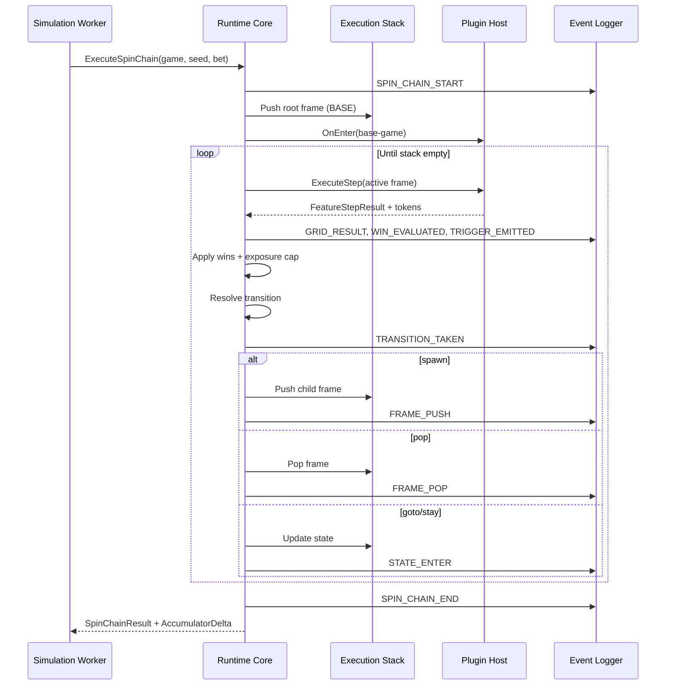

# Runtime Core — Detailed Design Specification

**Version:** 1.0.0
**Status:** FROZEN IMPLEMENTATION CONTRACT — Implementation Approved v1.0.0
**Audience:** Engineering, Game Mathematics, Architecture
**Last Updated:** 2026-06-14
**Architecture Review:** 2026-06-14 — production review incorporated (see §25)

> ## Change Control
>
> This document is a frozen implementation contract for Runtime Core v1.0.0.
>
> During implementation:
>
> - Non-semantic clarifications and typo fixes MAY be made.
> - Architectural changes MUST require:
>   - ADR update or creation
>   - Version bump of this document
>   - Review of affected Golden Fixtures
>   - Review of impacted schemas and validation rules
>
> Runtime Core implementations MUST conform to this specification.
> Runtime Core implementation MUST follow this specification exactly. Any deviation MUST be documented through ADRs before implementation proceeds.

---

## Purpose

This document specifies the **Runtime Core** — the deterministic execution engine that drives slot game mathematics simulation. It consumes a validated, immutable `GameVersion` snapshot and produces per-spin outcomes, win amounts, runtime events, and accumulator inputs for the Mathematical Engine.

This specification is **normative for implementation**. Where it conflicts with higher-precedence artifacts, those artifacts win (see §2). Implementers **MUST** follow [CURSOR_RULES.md](./CURSOR_RULES.md).

---

## RFC 2119 Key Words

The key words **MUST**, **MUST NOT**, **SHOULD**, **SHOULD NOT**, and **MAY** in this document are to be interpreted as described in [RFC 2119](https://www.rfc-editor.org/rfc/rfc2119).

---

## Table of Contents

1. [Related Documents and Precedence](#1-related-documents-and-precedence)
2. [Scope and Boundaries](#2-scope-and-boundaries)
3. [Architectural Position](#3-architectural-position)
4. [Design Principles](#4-design-principles)
5. [Package Structure](#5-package-structure)
6. [Core Domain Model](#6-core-domain-model)
7. [Session and Execution Stack](#7-session-and-execution-stack)
8. [Spin Chain Lifecycle](#8-spin-chain-lifecycle)
9. [Step Execution Loop](#9-step-execution-loop)
10. [Transition Resolution](#10-transition-resolution)
11. [Plugin Host](#11-plugin-host)
12. [Built-in Plugin Execution Contract](#12-built-in-plugin-execution-contract)
13. [RNG Service](#13-rng-service)
14. [Money and Win Application](#14-money-and-win-application)
15. [Context Inheritance (mvp-v1)](#15-context-inheritance-mvp-v1)
16. [Exposure Enforcement](#16-exposure-enforcement)
17. [Runtime Safety Limits](#17-runtime-safety-limits)
18. [Event Emission](#18-event-emission)
19. [Public API](#19-public-api)
20. [Error Handling and Fault Semantics](#20-error-handling-and-fault-semantics)
21. [Integration Points](#21-integration-points)
22. [Testing Strategy](#22-testing-strategy)
23. [Implementation Phases](#23-implementation-phases)
24. [Open Decisions](#24-open-decisions)
25. [Architecture Review — Risks and Mitigations](#25-architecture-review--risks-and-mitigations)
26. [Appendix A: Transition Resolution Flow](#appendix-a-transition-resolution-flow)
27. [Appendix B: Stack Example (Base → FS → H&W)](#appendix-b-stack-example-base--fs--hw)
28. [Appendix C: Sequence Diagram (Single Spin Chain)](#appendix-c-sequence-diagram-single-spin-chain)

---

## 1. Related Documents and Precedence

| Priority | Document                                                     | Relevance                                   |
| -------- | ------------------------------------------------------------ | ------------------------------------------- |
| 1        | [ADR-004](./adr/ADR-004-state-machine-execution-model.md)    | Hierarchical stack FSM (Accepted)           |
| 2        | [CANONICAL_GAME_SCHEMA_V1.md](./CANONICAL_GAME_SCHEMA_V1.md) | §12 Events, §16 Context, §18 Limits         |
| 3        | [TECHNICAL_SPECIFICATION.md](./TECHNICAL_SPECIFICATION.md)   | §F State Machine, §G Plugins, §H Simulation |
| 4        | [CURSOR_RULES.md](./CURSOR_RULES.md)                         | Engineering constitution                    |
| 5        | [GOLDEN_FIXTURES_V1.md](./GOLDEN_FIXTURES_V1.md)             | Regression gates                            |
| 6        | ADR-002, ADR-003                                             | RNG and money (Proposed — see §24)          |

**Validation Engine** is implemented under `packages/runtime-core/internal/validation/` as a logically separate bounded context. Runtime Core **MUST NOT** re-implement validation rules.

---

## 2. Scope and Boundaries

### 2.1 In Scope (MVP)

Runtime Core **MUST** implement:

| Capability                | Description                                |
| ------------------------- | ------------------------------------------ |
| Stack-based FSM execution | Push/pop child machines per ADR-004        |
| Transition execution      | `stay`, `goto`, `spawn`, `pop` effects     |
| Built-in plugin hosting   | Four MVP plugins only                      |
| Deterministic RNG scoping | Per-shard, per-chain, per-frame draws      |
| Win application           | `int64` minor units; RTP category tagging  |
| Exposure cap enforcement  | When `exposure.enforceCap: true`           |
| Runtime safety limits     | Step, frame, transition, event guards      |
| Event emission            | Per Canonical Schema §12 (mode-controlled) |

### 2.2 Out of Scope (MVP)

Runtime Core **MUST NOT** implement:

| Excluded                                        | Owner                         |
| ----------------------------------------------- | ----------------------------- |
| Schema / graph validation                       | Validation Engine             |
| RTP, volatility, hit frequency calculation      | Mathematical Engine           |
| Simulation orchestration, sharding, aggregation | Simulation Engine             |
| Persistence, API, auth                          | API layer                     |
| AI services                                     | AI Assistant                  |
| Custom / WASM plugins                           | Post-MVP (ADR-005)            |
| Persistent cross-spin state (P3)                | Future policy `persistent-v1` |

### 2.3 Assumption

Runtime Core **MAY** assume the input `GameVersion` has passed the full Validation Engine pipeline (Schema → Graph → Plugin → Exposure → Limits). Defensive runtime checks **MAY** exist but **MUST** emit `RUNTIME_FAULT` events—not silently correct invalid graphs.

---

## 3. Architectural Position

```
┌─────────────────────────────────────────────────────────────┐
│                    Simulation Worker                         │
│  ┌─────────────────┐    ┌──────────────────────────────┐  │
│  │ Simulation      │───▶│ Runtime Core                  │  │
│  │ Orchestrator    │    │  • SessionExecutor            │  │
│  └─────────────────┘    │  • StackManager               │  │
│                         │  • TransitionResolver         │  │
│                         │  • PluginHost                 │  │
│                         │  • RNGService                 │  │
│                         │  • EventLogger                │  │
│                         └──────────────┬───────────────┘  │
│                                        │ events, wins       │
│                         ┌──────────────▼───────────────┐  │
│                         │ Local Accumulator             │  │
│                         └──────────────────────────────┘  │
└─────────────────────────────────────────────────────────────┘
         ▲                              │
         │ validated GameVersion        ▼
┌────────┴────────┐           ┌─────────────────┐
│ Validation      │           │ Mathematical    │
│ Engine          │           │ Engine          │
└─────────────────┘           └─────────────────┘
```

**Dependency rule:** `runtime-core` → `domain`, `game-schema` (types/registries), `plugins` (built-in). **MUST NOT** depend on API, web, or AI packages.

---

## 4. Design Principles

| #   | Principle                                | Requirement                                                                                                                 |
| --- | ---------------------------------------- | --------------------------------------------------------------------------------------------------------------------------- |
| P1  | **Determinism**                          | Identical `(GameVersion hash, engineVersion, masterSeed, spinChainIndex)` → identical outcomes and replay-comparable events |
| P2  | **Validation-first input**               | Never execute unvalidated snapshots in production paths                                                                     |
| P3  | **Separation of execution and analysis** | Runtime emits facts; Mathematical Engine derives metrics                                                                    |
| P4  | **Event transparency**                   | No hidden transitions; every meaningful action emits an event                                                               |
| P5  | **Integer money**                        | All win/bet math in `int64` minor units (see ADR-003 / CURSOR_RULES §5)                                                     |
| P6  | **Pure plugins**                         | Plugins are stateless except via provided frame context                                                                     |
| P7  | **Fail closed on limits**                | Safety limit breach terminates chain with `RUNTIME_LIMIT_HIT`                                                               |
| P8  | **Composition over inheritance**         | Small interfaces; dependency injection via constructors                                                                     |

---

## 5. Package Structure

Proposed layout within `packages/runtime-core/` (validation already exists):

```
packages/runtime-core/
├── internal/
│   ├── domain/                    # Shared GameVersion types (existing)
│   ├── validation/                # Validation Engine (implemented)
│   └── runtime/
│       ├── executor.go            # SessionExecutor — public entry
│       ├── session.go             # SessionContext, SpinChainResult
│       ├── stack.go               # ExecutionStack, Frame push/pop
│       ├── machine.go             # StateMachineRunner
│       ├── transitions.go         # TransitionResolver
│       ├── precedence.go          # Trigger order + priority sort
│       ├── context/
│       │   ├── session_context.go
│       │   ├── frame_context.go
│       │   └── policy_mvp_v1.go   # mvp-v1 inheritance rules
│       ├── plugins/
│       │   ├── host.go            # PluginHost, registry
│       │   ├── contract.go        # Plugin, StepResult interfaces
│       │   └── adapter/           # Bridges to packages/plugins/*
│       ├── rng/
│       │   ├── service.go
│       │   └── pcg64.go           # Default algorithm per canonical example
│       ├── money/
│       │   └── wins.go            # Win application, cap truncation
│       ├── exposure/
│       │   └── enforcer.go
│       ├── limits/
│       │   └── guard.go
│       └── events/
│           ├── logger.go
│           ├── types.go
│           └── hash.go            # eventLogHash computation
└── runtime.go                     # Exported facade (optional)
```

Built-in plugin **implementations** live in `packages/plugins/{base-game,free-spins,hold-and-win,multiplier}/` and are loaded by `PluginHost` via static manifest (Technical Specification §G.6).

---

## 6. Core Domain Model

### 6.1 Immutable Inputs

| Type                | Source                   | Mutability                           |
| ------------------- | ------------------------ | ------------------------------------ |
| `GameVersion`       | Canonical snapshot       | Immutable for duration of spin chain |
| `SimulationProfile` | Non-canonical run config | Immutable per run/shard              |
| `EngineVersion`     | Build metadata           | Pinned in profile                    |

### 6.2 Mutable Runtime State

| Type             | Scope                       | Lifetime                   |
| ---------------- | --------------------------- | -------------------------- |
| `SessionContext` | Entire simulated spin chain | One chain                  |
| `FrameContext`   | Single stack frame          | Push → pop                 |
| `ExecutionStack` | Ordered frames              | Grows/shrinks during chain |
| `StepCounter`    | Chain + per-frame           | Reset each chain           |

### 6.3 Key Value Objects

```go
// Conceptual — names illustrative; exact Go types defined at implementation.

type SpinChainRequest struct {
    Game           *domain.GameVersion
    Profile        *SimulationProfile
    MasterSeed     []byte
    SpinChainIndex int64
    BetMinorUnits  int64
}

type SpinChainResult struct {
    TotalWinMinorUnits         int64
    TotalUncappedWinMinorUnits int64
    TotalTruncatedMinorUnits   int64
    TotalBetMinorUnits         int64
    StepCount                  int
    FramePushCount             int
    ExposureCapApplied         bool
    LimitHit                   *LimitHit
    Fault                      *ChainFault          // nil if success
    Events                     []Event              // if logging enabled
    EventLogHash               string               // if logging enabled
    AccumulatorDelta           AccumulatorDelta
}

type FeatureStepResult struct {
    GridOutcome      *GridOutcome
    Wins             []WinComponent
    TriggerTokens    []string
    SpawnChild       *SpawnSpec       // deprecated path — prefer graph spawn transitions
    ConsumeStep      bool             // counts toward step limit
    FrameLocalPatch  map[string]any   // plugin-local state mutation request
}
```

**Note:** Plugins emit **trigger tokens**; the Runtime Core resolves **transitions** from the canonical graph. Plugins **MUST NOT** directly mutate stack or state IDs.

---

## 7. Session and Execution Stack

### 7.1 SessionContext

```
SessionContext {
  gameVersionContentHash: string
  engineVersion:          string
  spinChainIndex:         int64
  betContext:             BetContext      // immutable
  totalBetMinorUnits:     int64           // immutable for chain
  totalWinMinorUnits:     int64           // mutable via runtime win API
  masterSeed:             []byte
  rng:                    RNGHandle       // scoped service
  persistentStore:        map             // unused in MVP (mvp-v1)
  eventLogger:            EventLogger
  limits:                 EffectiveLimits
  exposure:               ExposureState
  inheritancePolicy:      string          // "mvp-v1"
}
```

### 7.2 ExecutionStack

Each **frame** represents one active state machine instance on the stack:

```
StateMachineFrame {
  frameId:           string    // stable within chain, e.g. "f-0-0", "f-1-0"
  machineId:         string    // key in game.stateMachines
  stateId:           string    // current state node
  pluginRefId:       string
  rtpCategory:       string    // from state.rtpCategory
  frameContext:      FrameContext
  pluginHandle:      PluginInstance
  frozen:            bool      // true when child frame is active above
}
```

### 7.3 Stack Operations

| Operation | Trigger                    | Behavior                                                                                 |
| --------- | -------------------------- | ---------------------------------------------------------------------------------------- |
| **Push**  | Transition `effect: spawn` | Create frame for `targetMachineId` at its `initialStateId`; parent frame `frozen = true` |
| **Pop**   | Transition `effect: pop`   | Destroy top frame; resume parent (`frozen = false`); emit `FRAME_POP`                    |
| **Stay**  | Transition `effect: stay`  | Remain in state; see §10.7 for lifecycle                                                 |
| **Goto**  | Transition `effect: goto`  | Change state within frame; see §10.7                                                     |

**Stack depth** **MUST NOT** exceed `session.maxStackDepth`. Push beyond limit **MUST** trigger `RUNTIME_LIMIT_HIT` (limit code `MAX_STACK_DEPTH`).

### 7.5 Frame Freeze Semantics

**Freeze definition:** A frame is `frozen` when a child frame exists above it on the stack. Freeze **ONLY** suspends **step scheduling** (`ExecuteStep`) for that frame. It **MUST NOT**:

- Reset or re-derive the frame's RNG stream (see §13.5)
- Discard `frameContext` or counter values
- Block reads of session-scoped data (`totalWinMinorUnits`, `betContext`)

| Concern                                 | mvp-v1 behavior                                             |
| --------------------------------------- | ----------------------------------------------------------- |
| Parent `ExecuteStep`                    | **Suspended** while frozen                                  |
| Parent counters (e.g. `spinsRemaining`) | **Frozen** — no decrement                                   |
| Parent RNG stream cursor                | **Preserved** — resumes on pop                              |
| Session `persistentStore`               | **Unreadable / unwritable** in MVP (store empty)            |
| Child wins                              | Applied to session totals with child `rtpCategory` (SI-002) |

**On `pop`:** Parent `frozen = false`; parent resumes on **next loop iteration** without `OnEnter` unless a transition changed parent state while child was active (not possible in MVP graph — parent state unchanged during spawn).

### 7.6 Future Persistent Features (`persistent-v1` — P3)

The `frozen` flag **MUST NOT** be overloaded to mean "no session-side effects." Phase 3 persistent collectors require:

| Mechanism                                  | Owner             | mvp-v1                 | persistent-v1 (future)                                                                                          |
| ------------------------------------------ | ----------------- | ---------------------- | --------------------------------------------------------------------------------------------------------------- |
| `ExecuteStep` on frozen parent             | Runtime scheduler | Blocked                | Blocked                                                                                                         |
| Session `persistentStore` writes           | Runtime API       | Blocked (empty store)  | **Allowed** via runtime win/meter API                                                                           |
| Passive meter ticks from child events      | Runtime           | N/A                    | **Allowed** — runtime translates child events to session store updates **without** calling parent `ExecuteStep` |
| Parent `frameLocalState` mutation by child | —                 | **Forbidden** (SI-001) | **Forbidden** unless new ADR                                                                                    |

**Extension rule:** New inheritance policies **MUST** be new policy ids (e.g. `persistent-v1`). Runtime Core **MUST** implement policy as a pluggable `ContextInheritancePolicy` interface; mvp-v1 remains default for all MVP fixtures.

**OnExit upward merge (all policies):** When a frame is popped or exited, plugins **MAY** return `ExitMergeRequest` (frame-local exports). Runtime Core **MUST** apply merges — plugins **MUST NOT** write parent context directly. MVP: H&W jackpot totals already in session wins; explicit merge deferred until P3 collector export.

### 7.4 Frame Identity

`frameId` **MUST** be deterministic:

```
frameId = "f-{stackIndex}-{pushSequenceWithinChain}"
```

Used in events, RNG sub-stream derivation, and replay comparison.

---

## 8. Spin Chain Lifecycle

A **spin chain** is one invocation of Runtime Core — the complete execution from root machine entry until the stack is empty or a terminal condition is reached.

### 8.1 Modes

Controlled by `session.spinLoopMode`:

| Mode           | MVP | Behavior                                                             |
| -------------- | --- | -------------------------------------------------------------------- |
| `single_chain` | Yes | One chain per simulated spin; stack must return to root and complete |
| `continuous`   | No  | Future — multiple base spins per session context                     |

### 8.2 Lifecycle Phases

```
1. INIT
   - Bind immutable GameVersion snapshot
   - Construct SessionContext (bet, seed, limits, exposure)
   - Initialize empty ExecutionStack
   - Push root frame (session.rootMachineId → initialStateId)
   - Emit SPIN_CHAIN_START

2. EXECUTE (see §9)
   - Loop until stack empty OR terminal OR limit hit

3. FINALIZE
   - Emit SPIN_CHAIN_END
   - Compute eventLogHash if logging enabled
   - Return SpinChainResult + AccumulatorDelta
```

### 8.3 Chain Termination Conditions

| Condition                                        | Result                                          |
| ------------------------------------------------ | ----------------------------------------------- |
| Stack empty after pop from root                  | Normal completion                               |
| Root state terminal with no outgoing transitions | Normal completion                               |
| `RUNTIME_LIMIT_HIT`                              | Abnormal; partial wins retained; flag in result |
| Unrecoverable plugin fault                       | Abnormal; fail chain                            |

---

## 9. Step Execution Loop

The inner loop executes **steps** until the active frame requires a transition or the chain ends.

```
WHILE stack not empty AND NOT limitHit:
  frame = stack.top()
  IF frame.frozen:
    BREAK inner — wait for child pop (only top frame executes)

  result = frame.plugin.ExecuteStep(frame.frameContext, frame.rng)

  emit GRID_RESULT, WIN_EVALUATED, TRIGGER_EMITTED as applicable
  applyWins(result.wins)           // session.totalWinMinorUnits += capped wins
  applyExposureCap()               // may emit EXPOSURE_CAP_APPLIED

  tokens = result.triggerTokens
  transition = resolveTransition(frame, tokens)   // §10

  IF transition.effect == spawn:
    pushChildMachine(transition.targetMachineId)
  ELIF transition.effect == pop:
    popFrame()
  ELIF transition.effect == goto:
    gotoState(transition.targetStateId)
  ELIF transition.effect == stay:
    stayInState(transition.targetStateId OR current)

  increment stepCounter
  IF stepCounter > maxStepsPerSpinChain: RUNTIME_LIMIT_HIT
```

### 9.1 Step vs Transition

| Concept              | Definition                                                                 |
| -------------------- | -------------------------------------------------------------------------- |
| **Step**             | One plugin `ExecuteStep` call on the active frame                          |
| **Transition**       | Graph edge taken after tokens are emitted                                  |
| **Multi-step state** | One state, many steps (e.g., Hold & Win respins) before `FEATURE_COMPLETE` |

Hold & Win **MUST** remain in `HAW_RESPINS` state across respin steps; only `progression` metadata and plugin context change until `FEATURE_COMPLETE` triggers pop.

---

## 10. Transition Resolution

Transition resolution **MUST** be deterministic and **MUST** align with Canonical Schema §6.5 and §14.4 (two-layer model).

### 10.1 Two-Phase Resolution Algorithm

Resolution **MUST NOT** merge trigger selection and transition selection into a single sort over heterogeneous triggers. Use two phases:

**Phase A — Token selection** (when `|T| > 1`):

```
1. Let T = emitted trigger tokens from plugin
2. Map each t ∈ T to precedence.triggerOrder index (missing → fault RUNTIME_FAULT AMBIGUOUS_TRIGGER)
3. Select token t* with minimum index
4. If tie on index: RUNTIME_FAULT AMBIGUOUS_TRIGGER (Validation GV-017 should have rejected)
```

**Phase B — Transition selection** (for token `t*`):

```
1. candidates = transitions in current state where transition.trigger == t*
2. Filter by guard (if present; MVP: skip when no guards)
3. Sort candidates by:
   a. transition.priority ascending (lower = higher precedence)
   b. transition.priorityTier registry defaultPriority ascending (tie-break among tiers)
   c. transition.id lexicographic (stable tie-break ONLY — see §10.6)
4. Select first candidate
5. If no candidate: RUNTIME_FAULT NO_MATCHING_TRANSITION
```

**Single token emitted:** Phase A skipped; `t*` is the sole token.

**Empty tokens:** Fall back to `SPIN_COMPLETE` candidates if plugin declared step complete; else `NO_MATCHING_TRANSITION` or continue multi-step (Hold & Win mid-respin).

### 10.2 Effect Handling

| Effect  | Precondition                                         | Action                                        |
| ------- | ---------------------------------------------------- | --------------------------------------------- |
| `stay`  | `targetStateId` optional (defaults to current)       | See §10.7 — lightweight re-entry              |
| `goto`  | `targetStateId` exists; **MUST differ from current** | Full lifecycle §10.7                          |
| `spawn` | `targetMachineId` exists                             | Push child at `initialStateId`; parent frozen |
| `pop`   | Stack depth > 1                                      | Pop top frame; parent unfrozen                |

Validation Engine **SHOULD** reject `goto` where `targetStateId == currentStateId` (`GV-038` — reserved); if encountered at runtime, treat as `stay` and emit `RUNTIME_FAULT` warning code `GOTO_SELF_NORMALIZED`.

### 10.3 Spawn Priority

When Phase A selects among competing tokens (e.g. `HOLD_AND_WIN` vs `FREE_SPINS`), `game.precedence.triggerOrder` is authoritative. Golden Fixture 4:

```json
"triggerOrder": ["HOLD_AND_WIN", "FREE_SPINS", "FEATURE_COMPLETE", "SPIN_COMPLETE"]
```

### 10.4 Guard Evaluation (MVP)

Guard expressions **MAY** be deferred in MVP. When implemented, guards **MUST** be pure functions of `(sessionContext, frameContext)` with no I/O.

### 10.5 Ambiguity and Tie-Breaking Policy

| Situation                                                                | Runtime behavior                                 | Validation expectation                    |
| ------------------------------------------------------------------------ | ------------------------------------------------ | ----------------------------------------- |
| Equal `(trigger, priority, priorityTier)` with different `transition.id` | Apply lexicographic `transition.id`              | `GV-016` warning; allowed but discouraged |
| Equal rank, same id impossible                                           | N/A                                              | —                                         |
| Phase A token tie                                                        | `RUNTIME_FAULT AMBIGUOUS_TRIGGER`; fail chain    | `GV-017` error                            |
| Phase B tie after sort keys exhausted                                    | `RUNTIME_FAULT AMBIGUOUS_TRANSITION`; fail chain | Should not occur if validation clean      |

**Production rule:** Lexicographic `transition.id` **MUST NOT** be relied upon as a **design** mechanism. It exists only as a **deterministic last resort** when authors/compilers emit distinct ids at equal rank. Compiler **SHOULD** assign non-colliding priorities instead.

Runtime **MUST NOT** pick randomly or use map iteration order.

### 10.6 Goto vs Stay Lifecycle

| Transition                     | `targetStateId` vs current | `OnExit`           | `OnEnter` | `STATE_ENTER` event                              |
| ------------------------------ | -------------------------- | ------------------ | --------- | ------------------------------------------------ |
| **goto**                       | **Must differ**            | Yes                | Yes       | Yes — new state id                               |
| **stay**                       | Same (explicit or default) | **No**             | **No**    | Optional `STATE_REENTER` (debug/full modes only) |
| **goto** (invalid self-target) | Same                       | Normalized to stay | —         | `RUNTIME_FAULT` + stay path                      |

**Rationale:** Hold & Win respins use **stay** in the same state without re-initializing plugin context. Feature entry/exit uses **goto**. Re-running `OnEnter` on every respin would reset counters incorrectly.

**Plugin re-bind:** On **goto** to a state with a different `pluginRefId`, Runtime Core **MUST** `OnExit` old plugin, bind new plugin, `OnEnter` new plugin. On **stay**, plugin instance **MUST** persist.

---

## 11. Plugin Host

### 11.1 Responsibilities

| Responsibility                                                 | Owner                                     |
| -------------------------------------------------------------- | ----------------------------------------- |
| Static plugin registry                                         | PluginHost                                |
| Plugin instance lifecycle (`onEnter`, `ExecuteStep`, `onExit`) | PluginHost                                |
| Config binding from `state.pluginConfig`                       | PluginHost                                |
| Capability verification                                        | Validation Engine (runtime assumes valid) |
| RNG scoping per frame                                          | PluginHost + RNGService                   |

### 11.2 Static Registry (MVP)

```go
type PluginRegistry interface {
    Resolve(pluginID, version string) (PluginFactory, error)
}

// MVP manifest — compile-time registered
var BuiltInPlugins = []PluginDescriptor{
    {ID: "core.base-game",    Version: "1.0.0"},
    {ID: "core.free-spins",    Version: "1.0.0"},
    {ID: "core.hold-and-win", Version: "1.0.0"},
    {ID: "core.multiplier",   Version: "1.0.0"},
}
```

### 11.3 Plugin Instance Lifecycle

```
onEnter(frameContext, config)   — called when state becomes active
loop:
  ExecuteStep(ctx, rng)       — produces FeatureStepResult
onExit(frameContext)          — called before leaving state (goto) or pop
```

Multiplier plugin **MUST** be invoked by **PluginHost** (Runtime Core), not by direct plugin-to-plugin calls. Parent plugins request multiplier application via `FeatureStepResult` metadata; host calls multiplier and emits `MULTIPLIER_APPLIED`.

---

## 12. Built-in Plugin Execution Contract

### 12.1 Interface

```go
type Plugin interface {
    ID() string
    Version() string
    OnEnter(ctx FrameContext, config map[string]any) error
    ExecuteStep(ctx FrameContext, rng RNG) (FeatureStepResult, error)
    OnExit(ctx FrameContext) error
}
```

### 12.2 Plugin Responsibilities

| Plugin           | ExecuteStep produces                    | Typical triggers                                                 |
| ---------------- | --------------------------------------- | ---------------------------------------------------------------- |
| **base-game**    | Grid, line/scatter wins                 | `FREE_SPINS`, `HOLD_AND_WIN`, `SPIN_COMPLETE`                    |
| **free-spins**   | Grid, wins, spin decrement              | `HOLD_AND_WIN`, `FEATURE_COMPLETE`, `RETRIGGER`, `SPIN_COMPLETE` |
| **hold-and-win** | Grid step, held symbols, respin counter | `FEATURE_COMPLETE`, internal step tokens                         |
| **multiplier**   | Win adjustment                          | Invoked by reference; no direct transitions                      |

### 12.3 Trigger Token Emission Rules

- Tokens **MUST** match transition `trigger` strings in the canonical graph.
- Plugins **MUST NOT** emit tokens not declared by their config (e.g., scatter count thresholds).
- `SPIN_COMPLETE` **SHOULD** be emitted at end of every atomic spin step unless a feature transition takes precedence on the same step.

### 12.5 Runtime Core vs Plugin Ownership

| Concern                          | Runtime Core                           | Plugin                                |
| -------------------------------- | -------------------------------------- | ------------------------------------- |
| Stack push/pop/goto/stay         | **Owns**                               | Must not invoke                       |
| Transition / token selection     | **Owns** Phase A/B (§10)               | Emits tokens only                     |
| Trigger token strings            | Validates against graph                | **Emits**                             |
| Grid generation / paytable math  | Orchestrates                           | **Computes** inside `ExecuteStep`     |
| Raw win amounts                  | Receives                               | **Proposes** in `FeatureStepResult`   |
| RTP category tagging             | **Owns** (from `state.rtpCategory`)    | Must not tag                          |
| Exposure truncation              | **Owns** (§16)                         | Must not cap                          |
| Session / frame counter mutation | **Owns** — applies patches from result | Requests via result fields + events   |
| `frameLocalState` storage        | **Owns** storage                       | Mutates only through returned patches |
| RNG draws                        | **Owns** stream scope                  | Draws via injected `RNG` only         |
| Multiplier application           | **Owns** via PluginHost                | Multiplier plugin stateless step      |
| Event emission                   | **Owns** envelope + sequence           | Provides payload facts                |
| Validation                       | Assumes pre-validated input            | Must not validate graph               |

Plugins **MUST NOT** import sibling plugins. Cross-plugin references (`multiplierRefId`) are resolved by PluginHost at runtime.

### 12.6 Retrigger Semantics

Free Spins retriggers **MUST**:

1. **NOT** push a new stack frame
2. Request counter updates via `FeatureStepResult` — Runtime Core applies `spinsRemaining` and emits `FEATURE_COUNTER_UPDATE`
3. Emit `RETRIGGER` token only if a transition requires it (MVP: counter mutation may suffice without transition)

---

## 13. RNG Service

### 13.1 Requirements

| Requirement      | Source                                           |
| ---------------- | ------------------------------------------------ |
| Deterministic    | ADR-002 invariants, CURSOR_RULES §4              |
| Scoped streams   | No plugin access to raw global RNG               |
| Auditable draws  | Optional `RNG_DRAW` events in replay mode        |
| Algorithm pinned | `GameVersion.determinism.rngAlgorithm` + version |

### 13.2 Default Algorithm (Canonical Example)

Canonical Appendix A specifies:

```json
"determinism": {
  "rngAlgorithm": "PCG64",
  "rngAlgorithmVersion": "1.0",
  "seedDerivationPolicy": "v1-hash-shard"
}
```

Runtime Core **SHOULD** implement PCG64 as default MVP algorithm. Final selection **MUST** be recorded in ADR-002 when Accepted.

### 13.3 Seed Derivation and Stream Allocation

```
shardSeed       = HMAC-SHA256(masterSeed, shardIndex || simulationRunId)
chainSeed       = HMAC-SHA256(shardSeed, spinChainIndex)
frameStreamSeed = HMAC-SHA256(chainSeed, frameId)
stepStreamSeed  = HMAC-SHA256(frameStreamSeed, "step:" || stepIndexInFrame)
multiplierSeed  = HMAC-SHA256(frameStreamSeed, "mult:" || multiplierRefId || ":" || applyIndex)
```

| Stream                | Scope                             | Frozen frame behavior                            |
| --------------------- | --------------------------------- | ------------------------------------------------ |
| `chainSeed`           | One spin chain                    | Immutable                                        |
| `frameStreamSeed`     | One stack frame instance          | **Cursor preserved** while frame frozen          |
| `stepStreamSeed`      | One `ExecuteStep` on active frame | New derivation per step                          |
| Multiplier sub-stream | One multiplier application        | Independent cursor; does not advance grid stream |

**Draw monotonicity:** Within a step, draw order **MUST** be: grid draws → win evaluation draws → multiplier draws → any pick-mechanic draws. Documented order change is a **breaking engine change**.

**Nested features:** Each spawned frame **MUST** use a new `frameId` and therefore a **distinct** `frameStreamSeed`. Re-spawning the same machine later in the chain **MUST** allocate a new `frameId` (new push sequence) — intentional isolation.

**Reproducibility guarantees:**

| Input pinned                                               | Guarantee                                                        |
| ---------------------------------------------------------- | ---------------------------------------------------------------- |
| `(contentHash, engineVersion, masterSeed, spinChainIndex)` | Identical wins, events (excl. `timestampUs`), accumulator deltas |
| Same + `shardIndex`                                        | Shard-local chains independent; merge commutative                |
| Plugin draw count change                                   | Breaks replay hash — semver engine bump                          |

Derivation **MUST** be stable across process restarts and shard merge order. Algorithm and policy **MUST** match `GameVersion.determinism.seedDerivationPolicy` (MVP: `v1-hash-shard`).

### 13.4 Plugin RNG Access

Plugins receive `RNG` interface:

```go
type RNG interface {
    NextUint64() uint64
    NextInt(n int) int   // 0 <= result < n
    DrawID() int         // for event correlation
}
```

Plugins **MUST NOT** construct their own RNG instances.

---

## 14. Money and Win Application

### 14.1 Representation

All amounts **MUST** use `int64` minor units per `GameVersion.determinism.moneyScale` (default `10000`).

Floating-point **MUST NOT** appear in win calculation paths (CURSOR_RULES §5, ADR-003 direction).

### 14.2 Win Application Pipeline

```
1. Plugin computes raw win components (paytable lookup × bet per line)
2. Multiplier plugin applies factor (if configured)
3. Runtime tags each component with state.rtpCategory
4. Exposure enforcer truncates to effective cap (§16)
5. SessionContext.totalWinMinorUnits += capped total
6. Emit WIN_EVALUATED with components[] and rtpCategory
7. AccumulatorDelta updated (for Mathematical Engine)
```

### 14.3 Bet Context

Bet for win calculation **MUST** always derive from session root:

```
totalBetMinorUnits = betModel.lineCount × defaultCoinValue × coinValueScale
                   OR betModel.totalBetMinorUnits if set
```

Child frames **MUST NOT** alter bet basis unless future ADR explicitly allows ante features.

---

## 15. Context Inheritance (mvp-v1)

Policy id: `session.contextInheritancePolicy = "mvp-v1"` (Canonical Schema §16).

### 15.1 Rules (Normative)

| Rule ID    | Requirement                                                                        |
| ---------- | ---------------------------------------------------------------------------------- |
| **SI-001** | Child frames **MUST NOT** mutate parent `frameLocalState`                          |
| **SI-002** | Child wins **MUST** add to `session.totalWinMinorUnits` with child's `rtpCategory` |
| **SI-003** | Multipliers apply within frame only in MVP                                         |
| **SI-004** | Bet amount **MUST** come from session root                                         |

### 15.2 Freeze / Resume

When `spawn` pushes a child frame:

- Parent plugin **MUST NOT** receive `ExecuteStep` calls while frozen
- Parent counters (e.g., `spinsRemaining`) **MUST NOT** decrement while frozen
- On `pop`, parent resumes with preserved frame context

### 15.3 FrameContext Fields (MVP)

| Field              | Owner           | Notes                                  |
| ------------------ | --------------- | -------------------------------------- |
| `spinsRemaining`   | free-spins      | Decrements on each FS step when active |
| `respinsRemaining` | hold-and-win    | Decrements per respin step             |
| `heldSymbols`      | hold-and-win    | Grid occupancy state                   |
| `activeMultiplier` | multiplier ref  | Resolved per frame                     |
| `frameLocalState`  | plugin-specific | opaque to runtime except events        |

---

## 16. Exposure Enforcement

Independent of validation mode, runtime **MUST** honor `exposure.enforceCap`.

### 16.1 Effective Cap

```
effectiveCap = min(
  exposure.maxWinMinorUnits,
  exposure.maxWinMultiplier × session.totalBetMinorUnits   // if multiplier set
)
```

Scope `capScope: session_spin_chain` (MVP): cap applies to cumulative chain wins.

### 16.2 Truncation Behavior

When `enforceCap: true` and cumulative win exceeds cap:

1. Compute `uncappedIncremental` from plugin wins
2. Compute `cappedIncremental = max(0, effectiveCap - totalWinBeforeStep)`
3. Apply only `cappedIncremental` to `session.totalWinMinorUnits`
4. Emit `WIN_EVALUATED` with **both** `totalWinMinorUnits` (capped applied) and `uncappedWinMinorUnits` fields
5. Emit `EXPOSURE_CAP_APPLIED` with `{ capMinorUnits, uncappedWinMinorUnits, truncatedMinorUnits, capScope }`
6. Set `SpinChainResult.ExposureCapApplied = true`

### 16.3 Observability Requirements

Exposure truncation **MUST** be observable at three layers:

| Layer                | Required fields                                                                                                                         |
| -------------------- | --------------------------------------------------------------------------------------------------------------------------------------- |
| **Events**           | `EXPOSURE_CAP_APPLIED` every truncation; `WIN_EVALUATED.uncappedWinMinorUnits` when truncation occurred                                 |
| **SpinChainResult**  | `ExposureCapApplied`, `TotalWinMinorUnits` (capped), `TotalUncappedWinMinorUnits`, `TotalTruncatedMinorUnits`                           |
| **AccumulatorDelta** | Separate commutative counters: `cappedWinMinorUnits`, `uncappedWinMinorUnits`, `exposureTruncationCount`, `exposureTruncatedMinorUnits` |

Mathematical Engine **MUST** use capped totals for RTP compliance metrics and **SHOULD** report uncapped totals when `exposureTruncationCount > 0` (Canonical §15.5).

`SPIN_CHAIN_END` payload **MUST** include `{ totalWinMinorUnits, totalUncappedWinMinorUnits, exposureCapApplied, effectiveCapMinorUnits }`.

Simulation reports **SHOULD** surface truncation rate (`exposureTruncationCount / spinCount`) for QA review.

---

## 17. Runtime Safety Limits

Effective limits = minimum of platform defaults, `session.runtimeLimits`, and `SimulationProfile` overrides (Canonical §18).

### 17.1 MVP Limits

| Limit                    | Default         | On breach                       |
| ------------------------ | --------------- | ------------------------------- |
| `maxStepsPerSpinChain`   | 500             | Fail chain; `RUNTIME_LIMIT_HIT` |
| `maxFramesPerChain`      | `maxStackDepth` | Fail chain                      |
| `maxTransitionsPerStep`  | 8               | Fail chain                      |
| `maxRespinsPerFeature`   | 100             | Fail chain                      |
| `maxEventsPerChain`      | 10000           | Stop logging; continue metrics  |
| `maxWallClockMsPerChain` | 5000 (debug)    | Fail shard (dev only)           |

### 17.2 Enforcement Location

| Component              | Enforces                          |
| ---------------------- | --------------------------------- |
| `limits/guard.go`      | Step, frame, transition counters  |
| `stack.go`             | Push depth                        |
| `plugins/hold-and-win` | Respins per feature (cooperative) |
| `events/logger.go`     | Event count                       |

Golden fixtures **MUST** complete without limit hits (Canonical §18.5).

---

## 18. Event Emission

Events **MUST** conform to [CANONICAL_GAME_SCHEMA_V1.md §12](./CANONICAL_GAME_SCHEMA_V1.md#12-runtime-event-contract).

### 18.1 Required MVP Event Types

| Event                                 | Required when                  |
| ------------------------------------- | ------------------------------ |
| `SPIN_CHAIN_START` / `SPIN_CHAIN_END` | Always (if logging not `none`) |
| `FRAME_PUSH` / `FRAME_POP`            | Stack changes                  |
| `STATE_ENTER`                         | State activation               |
| `GRID_RESULT`                         | After reel stop                |
| `WIN_EVALUATED`                       | After win calculation          |
| `TRIGGER_EMITTED`                     | Plugin emits tokens            |
| `TRANSITION_TAKEN`                    | Every transition               |
| `MULTIPLIER_APPLIED`                  | Multiplier invoked             |
| `EXPOSURE_CAP_APPLIED`                | Cap truncation                 |
| `FEATURE_COUNTER_UPDATE`              | Counter mutations              |
| `RUNTIME_LIMIT_HIT`                   | Limit breach                   |

### 18.2 Determinism

Replay hash **MUST** use:

```
eventLogHash = SHA-256(canonicalJsonLines(events excluding timestampUs))
```

Sequence numbers **MUST** be monotonic from 0 within each chain.

### 18.3 Event Log Modes

Controlled by `SimulationProfile.eventLog.mode` (not canonical):

| Mode               | Use                          |
| ------------------ | ---------------------------- |
| `none`             | Production metrics-only sims |
| `transitions_only` | Golden CI                    |
| `full`             | Debug                        |
| `replay`           | Full + `RNG_DRAW`            |

---

## 19. Public API

### 19.1 Primary Interface

```go
package runtime

type Executor interface {
    // ExecuteSpinChain runs one full spin chain for a validated game snapshot.
    ExecuteSpinChain(ctx context.Context, req SpinChainRequest) (*SpinChainResult, error)
}

type Config struct {
    EngineVersion   string
    PluginRegistry  PluginRegistry
    EventLogMode    EventLogMode
    PlatformLimits  LimitsDefaults
}
```

### 19.2 Construction

```go
func NewExecutor(cfg Config) (Executor, error)
```

Constructor **MUST**:

- Validate `cfg.EngineVersion` is non-empty
- Load built-in plugin registry
- **NOT** load or validate `GameVersion` (caller's responsibility)

### 19.3 Caller Responsibilities

| Caller            | Must do                               |
| ----------------- | ------------------------------------- |
| Simulation Worker | Pre-validate via Validation Engine    |
| Simulation Worker | Pin `engineVersion` in profile        |
| Simulation Worker | Provide derived shard seed            |
| Tests             | Load golden fixtures; compare metrics |

---

## 20. Error Handling and Fault Semantics

### 20.1 Error Categories

| Category                         | Handling                                          |
| -------------------------------- | ------------------------------------------------- |
| **Validation failure**           | Reject before Runtime Core invocation             |
| **Plugin error**                 | Fail chain; wrap with plugin id; emit fault event |
| **Limit hit**                    | Terminate chain; record partial result            |
| **Context cancelled**            | Return `ctx.Err()` promptly                       |
| **Internal invariant violation** | Fail chain; log; golden tests catch               |

### 20.2 Runtime Fault Events

Defensive checks **SHOULD** emit:

```json
{
  "eventType": "RUNTIME_FAULT",
  "payload": {
    "code": "INVARIANT_VIOLATION",
    "message": "...",
    "frameId": "f-1-0"
  }
}
```

These **MUST NOT** replace Validation Engine checks.

### 20.3 Panic Policy

Plugin code **MUST NOT** panic. PluginHost **MUST** recover panics from built-ins, emit `RUNTIME_FAULT` with code `PLUGIN_PANIC`, fail the **chain** (not the process), and return structured error to caller.

### 20.4 Fault Isolation at Simulation Scale

Large simulations (10⁶–10⁹ chains) **MUST NOT** abort an entire shard on a single chain fault unless explicitly configured.

**FaultPolicy** (Simulation Profile / worker config — not canonical):

| Policy       | Behavior                                                          | Use                         |
| ------------ | ----------------------------------------------------------------- | --------------------------- |
| `fail_chain` | Record fault; return partial chain result; **continue** next spin | **Default** production sims |
| `fail_shard` | Abort shard immediately                                           | Debug / golden CI           |
| `fail_run`   | Abort entire simulation run                                       | Strict certification replay |

Runtime Core **MUST** implement `fail_chain` only; worker selects policy.

**Per-chain fault handling:**

1. Emit `RUNTIME_FAULT` with `{ code, message, frameId, pluginRefId }`
2. Emit `SPIN_CHAIN_END` with `{ status: "faulted", faultCode }`
3. Return `SpinChainResult` with `Fault != nil` and wins accumulated **before** fault step
4. AccumulatorDelta **MUST** include `chainFaultCount` increment

**Invariant:** A plugin fault in chain _N_ **MUST NOT** corrupt RNG or accumulator state for chain _N+1_. Executor **MUST** allocate fresh chain scope per `ExecuteSpinChain` call.

**Golden CI:** Worker **MUST** use `fail_shard` so any fault fails the test run visibly.

---

## 21. Integration Points

### 21.1 Validation Engine

| Integration         | Direction            | Contract                                  |
| ------------------- | -------------------- | ----------------------------------------- |
| Pre-sim gate        | Validation → Runtime | `ValidationReport.Valid == true` required |
| No runtime feedback | Runtime ↛ Validation | Runtime does not invoke validator         |

Implemented: `packages/runtime-core/internal/validation/`.

### 21.2 Simulation Engine

| Integration                             | Contract                                 |
| --------------------------------------- | ---------------------------------------- |
| Worker loads snapshot once per shard    | Immutable `GameVersion`                  |
| Worker calls `ExecuteSpinChain` N times | One chain per simulated spin             |
| Accumulator merge                       | Commutative sums from `AccumulatorDelta` |

### 21.3 Mathematical Engine

| Input from Runtime        | Usage                     |
| ------------------------- | ------------------------- |
| `AccumulatorDelta`        | RTP, volatility, hit rate |
| Event log (optional)      | Decomposition, debugging  |
| `ExposureCapApplied` flag | Capped vs raw RTP         |

Runtime **MUST NOT** compute RTP.

### 21.4 Golden Test Framework

Golden tests **MUST**:

1. Load `tests/golden/fixture-*/game.canonical.json`
2. Validate via Validation Engine
3. Execute fixture `simulation.profile.yaml` spin count
4. Compare metrics to `expected.yaml` (when populated)

Runtime changes **MUST NOT** merge without golden pass (CURSOR_RULES §11).

---

## 22. Testing Strategy

### 22.1 Test Layers

| Layer           | Focus                                          | Coverage target               |
| --------------- | ---------------------------------------------- | ----------------------------- |
| Unit            | Stack, resolver, RNG derivation, money, limits | ≥ 90% for `internal/runtime/` |
| Plugin contract | Each built-in plugin in isolation              | ≥ 90%                         |
| Integration     | Full chain per golden fixture flow             | Required                      |
| Golden          | Spreadsheet-aligned metrics                    | CI gate                       |
| Determinism     | Same seed → same events hash                   | Required                      |

### 22.2 Required Test Cases (MVP)

| Case                    | Fixture / scenario                        |
| ----------------------- | ----------------------------------------- |
| Base game only          | fixture-01                                |
| Base → Free Spins       | fixture-02                                |
| Base → Hold & Win       | fixture-03                                |
| Base → FS → H&W nested  | fixture-04                                |
| Spawn + pop stack       | fixture-04 step-through                   |
| Exposure cap truncation | Synthetic high-paytable game              |
| Limit hit               | Misconfigured test double (not in golden) |
| Shard equivalence       | 1 shard vs N shards same metrics          |

### 22.3 Replay Verification

Tests **SHOULD** verify:

```
execute(seed, chainIndex) twice → identical eventLogHash (mode=replay)
```

---

## 23. Implementation Phases

Implementation **SHOULD** proceed in this order (one bounded context per phase — CURSOR_RULES §13):

| Phase  | Deliverable                                    | Dependency               |
| ------ | ---------------------------------------------- | ------------------------ |
| **R1** | Domain types, RNG service, event types         | Validation Engine (done) |
| **R2** | Execution stack + transition resolver          | R1                       |
| **R3** | Plugin host + base-game plugin integration     | R2                       |
| **R4** | free-spins + hold-and-win + multiplier         | R3                       |
| **R5** | Exposure enforcer + limits guard               | R4                       |
| **R6** | SessionExecutor public API + accumulator delta | R5                       |
| **R7** | Golden fixture integration tests               | R6                       |

Simulation Engine integration **MUST NOT** begin until **R6** passes golden fixture-01.

---

## 24. Open Decisions

The following **MUST** be resolved before implementation of affected components:

| ID     | Topic                                               | Status           | Blocker for     |
| ------ | --------------------------------------------------- | ---------------- | --------------- |
| OD-001 | RNG algorithm final selection                       | ADR-002 Proposed | R1 RNG service  |
| OD-002 | Money scale overflow bounds                         | ADR-003 Proposed | R5 exposure     |
| OD-003 | Guard expression language                           | Not specified    | Post-MVP guards |
| OD-004 | `packages/plugins/*` vs monolithic plugin code      | Folder structure | R3              |
| OD-005 | Exported package path (`runtime` vs `runtime-core`) | Naming           | R6 public API   |

**Interim defaults for implementation start:**

- PCG64 v1.0 per canonical Appendix A (OD-001)
- `int64` minor units, scale 10000 (OD-002)
- Guards disabled in MVP (OD-003)
- Plugins under `packages/plugins/` (OD-004)
- Facade at `packages/runtime-core/runtime/` (OD-005)

---

## 25. Architecture Review — Risks and Mitigations

Production architecture review (2026-06-14) identified the following risks. Items marked **Resolved** are addressed in this document version. **Remaining** items require ADR closure or implementation verification.

| ID     | Area                    | Risk                                                                                | Severity | Status        | Mitigation                                                                                    |
| ------ | ----------------------- | ----------------------------------------------------------------------------------- | -------- | ------------- | --------------------------------------------------------------------------------------------- |
| AR-001 | Frame freeze vs P3      | `frozen` blocks parent steps but P3 needs session meter updates from child activity | Medium   | **Resolved**  | §7.5–7.6 — freeze = step suspend only; P3 uses runtime meter API without parent `ExecuteStep` |
| AR-002 | Goto lifecycle          | `goto` self-target re-initializes state incorrectly                                 | High     | **Resolved**  | §10.6 — goto requires distinct target; stay for loops; `GOTO_SELF_NORMALIZED` fault           |
| AR-003 | Transition algorithm    | Single-sort conflates token + transition selection vs Canonical §14.4               | High     | **Resolved**  | §10.1 two-phase resolution                                                                    |
| AR-004 | Lexicographic tie-break | Authors rely on id ordering for behavior                                            | Medium   | **Resolved**  | §10.5 — last resort only; ambiguous → fault                                                   |
| AR-005 | RNG nested features     | Stream cursor reset on parent freeze breaks replay                                  | High     | **Resolved**  | §13.3 — preserve frame stream; explicit sub-streams for multiplier                            |
| AR-006 | RNG draw ordering       | Undocumented draw order shifts replay on plugin change                              | Medium   | **Resolved**  | §13.3 draw monotonicity + engine semver                                                       |
| AR-007 | Exposure observability  | Math engine cannot report uncapped RTP                                              | Medium   | **Resolved**  | §16.3 dual counters + events                                                                  |
| AR-008 | Sim-scale faults        | One bad chain kills million-spin shard                                              | High     | **Resolved**  | §20.4 `fail_chain` default; golden uses `fail_shard`                                          |
| AR-009 | Plugin boundaries       | Direct plugin-to-plugin multiplier calls                                            | Medium   | **Resolved**  | §11.3, §12.5 — PluginHost orchestrates                                                        |
| AR-010 | ADR-002 open            | RNG algorithm not formally Accepted                                                 | Medium   | **Remaining** | Implement PCG64 per interim default; Accept ADR-002 before v1.0.0 **release**                 |
| AR-011 | ADR-003 open            | Overflow bounds at max exposure                                                     | Medium   | **Remaining** | Add overflow checks in win path; Accept ADR-003                                               |
| AR-012 | Validation gap          | Runtime `GOTO_SELF` / Phase A ties not in Validation Engine yet                     | Low      | **Remaining** | Add `GV-038` + tighten GV-017 in validation pass (follow-up)                                  |
| AR-013 | Appendix B step 5       | Stack `[BASE]` then `[]` — FS exit path underspecified                              | Low      | **Resolved**  | FS uses `goto BASE`; stack never empty until chain ends at BASE idle                          |

**Approval statement:** With AR-001–AR-009 mitigations incorporated, Runtime Core design is **approved for implementation** at v1.0.0. AR-010–AR-012 **MUST** be closed before production release candidate, not before coding start.

---

## Appendix A: Transition Resolution Flow

```mermaid
flowchart TD
    A[Plugin ExecuteStep completes] --> B[Collect trigger tokens T]
    B --> C{|T| > 1?}
    C -->|Yes| D[Phase A: pick t* via triggerOrder]
    C -->|No| E[t* = sole token]
    D --> F{Token tie?}
    F -->|Yes| G[RUNTIME_FAULT AMBIGUOUS_TRIGGER]
    F -->|No| H[Phase B: candidates for t*]
    E --> H
    H --> I{Candidates empty?}
    I -->|Yes| J[SPIN_COMPLETE fallback or fault]
    I -->|No| K[Sort by priority, tier, id]
    K --> L{Ambiguous rank?}
    L -->|Yes| M[RUNTIME_FAULT AMBIGUOUS_TRANSITION]
    L -->|No| N[Emit TRANSITION_TAKEN]
    N --> O{Effect}
    O -->|spawn| P[FRAME_PUSH]
    O -->|pop| Q[FRAME_POP]
    O -->|goto| R[OnExit → OnEnter]
    O -->|stay| S[Lightweight re-enter]
```

---

## Appendix B: Stack Example (Base → FS → H&W)

| Step | Stack (bottom → top)      | Active      | Action                                                                       |
| ---- | ------------------------- | ----------- | ---------------------------------------------------------------------------- |
| 1    | `[BASE]`                  | BASE        | Base spin; 3 scatters → `FREE_SPINS`                                         |
| 2    | `[BASE, FREE_SPINS]`      | FREE_SPINS  | FS spin; BASE frozen                                                         |
| 3    | `[BASE, FREE_SPINS, HAW]` | HAW_RESPINS | 6 bonus → spawn; FS frozen                                                   |
| 4    | `[BASE, FREE_SPINS]`      | FREE_SPINS  | HAW `FEATURE_COMPLETE` → pop                                                 |
| 5    | `[BASE]`                  | BASE        | FS `FEATURE_COMPLETE` → **goto** BASE (stack depth 1)                        |
| 6    | `[BASE]`                  | BASE        | `SPIN_COMPLETE` → stay; chain completes when session terminal rule satisfied |

---

## Appendix C: Sequence Diagram (Single Spin Chain)



---

## Document Control

| Version | Date       | Changes                                                                                                                         |
| ------- | ---------- | ------------------------------------------------------------------------------------------------------------------------------- |
| 1.0.0   | 2026-06-14 | Initial Runtime Core Detailed Design Specification                                                                              |
| 1.0.0   | 2026-06-14 | **Implementation Approved v1.0.0** — production architecture review; §7.5–7.6, §10.1–10.6, §12.5–12.6, §13.3, §16.3, §20.4, §25 |
| 1.0.0   | 2026-06-14 | **FROZEN IMPLEMENTATION CONTRACT** — implementation governance and change control added                                         |

---

## Related Documents

- [TECHNICAL_SPECIFICATION.md](./TECHNICAL_SPECIFICATION.md)
- [CANONICAL_GAME_SCHEMA_V1.md](./CANONICAL_GAME_SCHEMA_V1.md)
- [CURSOR_RULES.md](./CURSOR_RULES.md)
- [GOLDEN_FIXTURES_V1.md](./GOLDEN_FIXTURES_V1.md)
- [ADR-004: State Machine Execution Model](./adr/ADR-004-state-machine-execution-model.md)

**This document is mandatory reading before Runtime Core implementation.**
